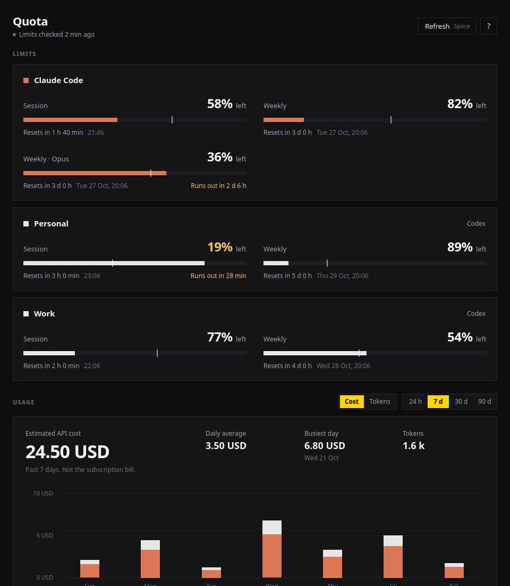

# Quota

Quota shows limits, usage, and cost. It reads the same local history as the T3 Code Usage panel.



## Install on Linux

Quota targets Linux with Qt 6.4 or newer, on Wayland or X11. Omarchy and Hyprland are optional; other desktops use the default accent and square corners. Build from source on the target computer so Qt and system libraries match. Windows and macOS are not supported builds.

Download the Arch x86_64 package from [release v0.3.0](https://github.com/vekhyat/quota/releases/tag/v0.3.0), then install it with `sudo pacman -U /path/to/quota-0.3.0-1-x86_64.pkg.tar.zst`. The binary requires the Qt version listed in its package dependencies; source builds support Qt 6.4 or newer.

To build on Arch Linux:

```sh
sudo pacman -S --needed base-devel qt6-base qt6-declarative qt6-wayland
bin/install
```

This builds, tests, and installs an Arch package. The system package conflicts with `quota-tools` because both install `/usr/bin/quota`. To keep `quota-tools`, use `bin/install --user` instead (requires Python 3); launch Quota from the desktop menu or `~/.local/bin/quota`.

On Debian 12 / Ubuntu 24.04 and newer:

```sh
sudo apt install build-essential qmake6 qt6-base-dev qt6-declarative-dev qt6-wayland python3 \
  qml6-module-qtquick qml6-module-qtquick-controls qml6-module-qtquick-layouts \
  qml6-module-qtquick-templates qml6-module-qtquick-window qml6-module-qtqml-workerscript
bin/install
```

Outside Arch, installation goes into `~/.local` without sudo. `PREFIX` overrides that location. On other distributions, install the equivalent Qt development packages, QML modules, and build tools, then run `bin/install --user`. `QMAKE` can select a Qt 6 qmake executable, and `JOBS` sets build parallelism.

Open **Quota** from your desktop's application menu. You can also run `build/quota` after `bin/build`. For systems with problematic GPU drivers, try `QT_QUICK_BACKEND=software build/quota`.

## Two Codex accounts

Each account needs its own Codex home, with its own login. For example:

```sh
CODEX_HOME="$HOME/.codex-personal" codex login
CODEX_HOME="$HOME/.codex-work" codex login
```

Use the matching `CODEX_HOME` when running Codex for that account. Quota automatically discovers these folders and shows each profile in its own card, with its session and weekly limits together. Card names come from the folder (for example, Personal or Work); hover the name to see its full path. Existing `~/.codex`, `CODEX_HOME`, and `QUOTA_CODEX_HOME` are supported too, including accounts that have no session history yet. Repeated paths and symlinks are scanned only once.

For profiles elsewhere, add their paths to `${XDG_CONFIG_HOME:-$HOME/.config}/quota/sources` (create the parent directory if needed):

```text
codex /path/to/personal-codex
codex /path/to/work-codex
```

Paths may contain spaces; do not quote them. Press **Space** in Quota to refresh after adding a profile. A failed account check displays that profile's path without hiding successful accounts. Codex must be on `PATH` for login refresh / keyring fallback; `QUOTA_CODEX_BIN` can point to it when your desktop launcher has a different `PATH`.

Usage and cost are combined across profiles; limits are separate. Signing different accounts into the same folder does not preserve both logins or let Quota attribute old sessions to each account. Separate profiles are required to track both limits concurrently. API-key accounts do not have ChatGPT subscription limits.

## Keys

| Key | Action |
| --- | --- |
| ? | Show the shortcut list |
| Q | Quit |
| Space | Refresh |
| C | Show cost |
| T | Show tokens |
| L | Scroll to limits |
| 1 | Past 24 hours |
| 2 | Past 7 days |
| 3 | Past 30 days |
| 4 | Past 90 days |

## Data

Usage and cost come from the Claude Code, Codex, Pi, and Grok history on this computer. T3 Code is not needed. If T3 Code is installed, its scan cache adds providers Quota does not read, such as Cursor or OpenCode. Prices come from the LiteLLM price list, with a built-in copy for offline use.

Quota finds every config: `~/.claude`, `~/.codex`, and siblings such as `~/.claude-work` or `~/.codex2`, plus `CLAUDE_CONFIG_DIR` and `CODEX_HOME`. List any other config in `~/.config/quota/sources`, one per line:

```
claude ~/work/claude-config
codex /mnt/data/codex
```

Limits use the Claude, Codex, and Grok logins on this computer. The cost is an API estimate. It is not the subscription bill.


## Limits

Each limit shows how much is left and when it resets. The thin mark on the bar shows how much of the window has passed. When the fill runs past the mark, the limit is burning faster than it resets, and the tile says when it runs out at that pace.

## Screenshot

`build/quota --preview screenshot.png 960x1100` renders sample data to an image and quits.

## Verification

Run `bin/test` for transcript parsing, profile discovery, and independent account checks using a fake Codex executable. The account tests never use your real credentials. Run `bin/smoke` after building to render the UI with an empty home and software graphics. CI runs both on Arch, Debian 12, and Ubuntu 24.04; a configured workflow is not a claim that every Linux desktop or GPU has been tested.
